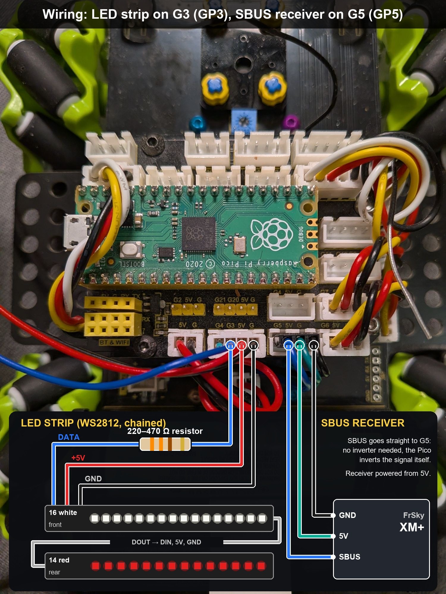

# KS3029 Pico Mecanum SBUS

Drive the **Keyestudio KS3029 4WD mecanum robot** (Raspberry Pi Pico) with a
real RC radio, like a drone: an SBUS receiver on the Pico, Mode 2 sticks,
an arm switch, failsafe, and car-like steering.

Click the image below to watch the full build tutorial on YouTube.
https://youtu.be/sBFCQ7uvDys

For the kit itself (parts, assembly, wiring, the original demo projects) see
the official Keyestudio KS3029 documentation:
[docs.keyestudio.com/projects/KS3029](https://docs.keyestudio.com/projects/KS3029/en/latest/).

MicroPython, no extra libraries. Tested on MicroPython **1.17** with a
RadioMaster radio and a FrSky XM+ receiver.

## Features

- **SBUS input** on GP5 (hardware UART, inverted RX), with frame resync and
  link / failsafe detection.
- **Mode 2 control**: right stick drives and strafes, left stick steers, the
  throttle sets the top speed.
- **Car-like steering**: while moving, yaw sets how tight the turn is relative
  to the speed, so the robot keeps going instead of stopping to spin. With the
  right stick centered, yaw spins on the spot.
- **Safe arming**: the arm switch has to be seen off before it arms, sticks
  must be centered, and any link loss disarms until the switch is cycled again.
- **Smooth drive**: expo on the sticks, slew-limited acceleration, per-wheel
  start duty and trim.
- **LEDs**: WS2812 status LEDs and an optional addressable strip, with an
  estimated current limit.
- **Drive recorder**: the last 30 s of sticks and wheel commands are saved on
  disarm, to analyze a drive without a cable.

## Hardware
| ITEM NO. | PART NUMBER | DESCRIPTION | QTY. |  Link |
| --- | --- | --- | --- | --- |
| 1 | KEYESTUDIO KS3029 | STEM Kit | 1 | https://s.click.aliexpress.com/e/_c4sfoTCt |
| 2 | 3D print | Tesla Cybertruck car body | 1 | download |
| 3 | 4x12 threadcutting screw | 4 x 12mm Thread cutting Screw | 4 | [Screws](https://s.click.aliexpress.com/e/_c3tJB8fL) |
| 4 | FrSky XM+ | SBUS receiver | 1 | [SBUS receiver](https://s.click.aliexpress.com/e/_c3x3OvGD) |
| 5 | Cell 18650 | Lithium-ion 18650 cell | 2 | [Batteries](https://de.aliexpress.com/item/1005012699594150.html?spm=a2g0o.productlist.main.7.3d9264c4Z03p9o&algo_pvid=d573643c-e5da-43c7-ab9c-812cde2d1faf&algo_exp_id=d573643c-e5da-43c7-ab9c-812cde2d1faf-6&pdp_ext_f=%7B%22order%22%3A%223%22%2C%22eval%22%3A%221%22%2C%22fromPage%22%3A%22search%22%7D&pdp_npi=6%40dis%21CHF%2126.40%213.35%21%21%21204.94%2125.98%21%400b88489f17953476699613695e0e8a%2112000059109744634%21sea%21CH%211653801957%21X%211%210%21n_tag%3A-29919%3Bd%3A6b705862%3Bm03_new_user%3A-29895%3BpisId%3A5000000221491402&curPageLogUid=eqEa4K1V9YI4&utparam-url=scene%3Asearch%7Cquery_from%3A%7Cx_object_id%3A1005012699594150%7C_p_origin_prod%3A) |
| 6 | WS2812B | Individually Addressable RGBIC COB LED | 1 | [Strip](https://s.click.aliexpress.com/e/_c3Ua3tFn) |


| Part | Pin |
|---|---|
| SBUS receiver signal (e.g. FrSky XM+) | GP5 |
| Motor co-processor (STC8, I2C 0x30, on the KS3029 board) | SDA GP20, SCL GP21 |
| On-board WS2812 status LEDs (4) | GP7 |
| Optional WS2812 strip (16 white + 14 red here) | GP3 |



Put a **220–470 Ω resistor** (330 Ω is typical) in series with the strip's
data line, close to the strip's DIN. It damps reflections and protects the
first LED's input; any value in that range works.

Power the receiver from the robot's 5 V. The strip runs from the sensor
shield's 5 V, which is rated about 200 mA, so the code caps it at 150 mA. For a
brighter strip use a separate 5 V buck converter (common ground with the Pico).

## Radio setup

Channel order AETR, Mode 2:

| Channel | Stick / switch | Robot |
|---|---|---|
| CH1 | Right stick left/right (roll) | Strafe sideways |
| CH2 | Right stick up/down (pitch) | Forward / back |
| CH3 | Left stick up/down (throttle) | Top speed, 15 % to 100 % |
| CH4 | Left stick left/right (yaw) | Steer / spin on the spot |
| CH6 | 3-position switch | Mode: manual / assisted / auto |
| CH7 | Switch, top position | Arm |

Set the receiver's failsafe to "no pulses" or "hold + failsafe flag"; the code
disarms on the SBUS failsafe flag and when frames stop for 100 ms.
Assisted mode currently drives like manual, and auto mode keeps the motors off.

### Compatible receivers

Any receiver with a normal (inverted) **SBUS** output works without code
changes:

- **Work as is:** FrSky receivers with an SBUS port (XM+, XM, R-XSR, X8R,
  X4R-SB, Archer RS/R4/R6/R8), Futaba S.BUS receivers, and RadioMaster,
  Jumper, BetaFPV and clones with an "SBUS" output.
- **Work after a receiver setting:** ExpressLRS 3.x receivers with the serial
  protocol set to **SBUS** (receiver Wi-Fi page or the ELRS Lua script; the
  default CRSF does not work), and multi-protocol receivers set to SBUS output.
- **Do not work without code changes:** FlySky iBUS, Spektrum DSM/SRXL, CRSF,
  PPM and PWM-only receivers, and the extra "uninverted SBUS" pad some
  receivers have (use their normal SBUS output instead).

Whatever the receiver: channel order AETR, mode on CH6, arm on CH7, failsafe
set to "no pulses" (or a receiver that sets the SBUS failsafe flag). Test it
with the wheels up: switch the radio off, the LEDs must blink red and the
wheels stop.

The SBUS signal must be **3.3 V**: the Pico's pins are not 5 V tolerant. Almost
all receivers are, even when powered from 5 V. If yours outputs 5 V, add a
divider (1 kΩ in series, 2 kΩ to GND).

## Install

The easiest way is [Thonny](https://thonny.org) (free, Windows / macOS /
Linux), a Python editor that can flash MicroPython and copy files to the Pico.

1. Flash MicroPython onto the Pico: hold BOOTSEL, plug in the USB cable, then
   in Thonny go to Tools > Options > Interpreter > Install or update
   MicroPython and choose target volume RPI-RP2, family RP2 (RP2040),
   variant "Raspberry Pi • Pico / Pico H" (not Pico W or Pico 2). (Or copy
   the `.uf2` from [micropython.org](https://micropython.org/download/RPI_PICO/)
   onto the RPI-RP2 drive.)
2. In Thonny, select the interpreter "MicroPython (RP2040)" (older versions:
   "MicroPython (Raspberry Pi Pico)"), press Stop, open View > Files, and
   upload these files to the Pico's root:
   `main.py`, `drive.py`, `motors.py`, `sbus.py`, `leds.py`, `settings.py`,
   `bench.py`
   (or use `mpremote cp`, or VS Code + MicroPico).
3. Reset the Pico (Ctrl+D in Thonny's Shell). `main.py` starts `drive.py` at boot.

`config.json` is created on the Pico when you save a setting; it is not part
of this repository.

## First-time setup

**Put the robot on a stand with the wheels off the ground.**

1. **Wheel directions** (the motor wiring varies): in the Pico's REPL
   (Thonny's Shell, or `mpremote repl`) after stopping the running program, type
   ```
   import bench; bench.run()
   ```
   It spins each wheel and asks whether it turned forward, then saves the result.
2. **Start duty**: `bench.start_sweep()` runs all wheels in rising low-power
   bursts; the strip shows the burst number. Set `min_duty` a little above
   where the wheels start (on the floor they need more than in the air).
3. **Radio check**: `mpremote run sbus_test.py` prints all channels and the
   failsafe flag live.

## Status LEDs

| LEDs | Meaning |
|---|---|
| Red, blinking | No link / failsafe |
| Amber | Arm switch was already on: switch it off once |
| Blue | Ready to arm |
| Green / cyan / magenta | Armed: manual / assisted / auto |

## Settings

Change them on the Pico, e.g.
`mpremote exec "import settings; settings.set('min_duty', 50)"`, then reset.

| Setting | Default | Meaning |
|---|---|---|
| `min_duty` | 50 | Duty where a wheel keeps turning on the floor |
| `max_duty` | 255 | Duty at full stick and full throttle |
| `start_boost` | FL 5 | Extra start duty per wheel for a stiffer motor |
| `trim` | all 1.0 | Per-wheel forward/back scale so it drives straight |
| `invert` | all false | Per-wheel direction, set by `bench.run()` |
| `expo` | 0.6 | Pitch/roll curve: higher = finer control near center |
| `yaw_expo` | 0.0 | Yaw curve |
| `arc` | 1.0 | Full yaw while moving: 1.0 = inner wheels stop, >1 tighter |
| `speed_min` | 0.15 | Top speed with the throttle at the bottom |
| `slew_per_s` | 4.0 | Max change of wheel command per second |
| `ch_reverse` | [] | Channels to reverse, 1-based, e.g. `[2]` |
| `debug` | true | Print status twice a second over USB |

## Drive recorder

While armed, the last 30 s are kept in RAM and written to `log.bin` on disarm.
Disarm before switching off. To read it:

```
mpremote cp :log.bin log.bin
python tools/log2csv.py log.bin log.csv
```

## Files

| File | Purpose |
|---|---|
| `main.py` | Runs at boot, starts `drive.py` |
| `drive.py` | Main loop: radio, arming, mixer, LEDs, recorder |
| `motors.py` | Motor co-processor driver (duty to I2C registers) |
| `sbus.py` | SBUS decoder and link check |
| `leds.py` | WS2812 driver via PIO, with current limit |
| `settings.py` | Defaults and `config.json` load/save |
| `bench.py` | Wheel direction and start-duty tests |
| `sbus_test.py` | Live radio channel monitor |
| `safe_main.py` | Stand-in `main.py` that only stops the motors |
| `tools/log2csv.py` | Converts the drive log on the PC |

## Disclaimer

Not affiliated with Keyestudio. This replaces the kit's demo code; the
original Keyestudio library is not included. Use at your own risk: test with
the wheels off the ground first.

## License

MIT, see [LICENSE](LICENSE).
